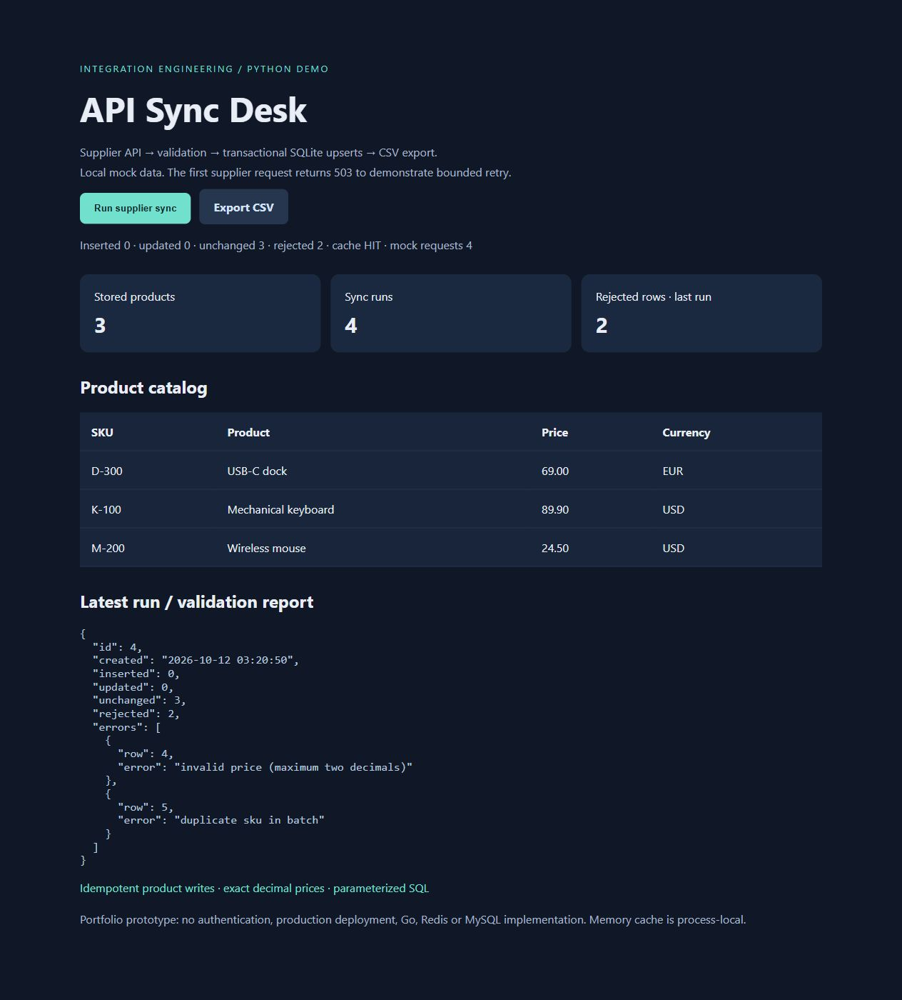

# API Sync Desk

A runnable Python portfolio prototype for a bounded API/data integration milestone. Synthetic supplier products flow through validation, SQLite persistence and CSV export, with a small browser dashboard.



## Run

Python 3.12+, no third-party dependencies:

```sh
python app.py
# open http://127.0.0.1:8767
python -m unittest -v
```

Click **Run supplier sync** twice. First run inserts 3 products and rejects 2 rows (negative price and duplicate SKU). The local mock initially returns HTTP 503; the client retries with bounded backoff. A second immediate run uses a 10-second memory cache and reports 3 unchanged products. Export downloads spreadsheet-safe CSV. Stop and restart the app to verify SQLite persistence; reset the demo by removing its generated demo.sqlite file after stopping it.

## Engineering details

- Timeout, 1 MB response limit, at most 5,000 rows; maximum three attempts for 429/502/503/504 and transport errors. Non-transient HTTP errors fail immediately. Invalid JSON is not retried.
- Per-row validation, row-numbered errors, duplicate detection; valid rows are written in one transaction. Repeating a batch does not duplicate products, but creates a new audit run.
- Exact decimal strings, currency validation, parameterized SQL, primary-key identity. CSV cells beginning with formula markers are prefixed with an apostrophe.
- Process-local TTL cache and synchronous loopback server. Supplier target is fixed to a local synthetic mock, not user-provided URLs.
- No automatic deletion of products missing from a batch. Failed upstream requests leave stored products intact.

## Scope and limitations

This is a **Python + SQLite demo**, not evidence of a shipped Go/Redis/MySQL/Nginx system. Those technologies are not implemented here. Production work would need an agreed API contract, authentication/secrets management, scheduling, pagination, migration strategy, concurrency controls, persistent job history, monitoring and deployment hardening. The dashboard is local only and has no authentication. Retry-After support and distributed caching are outside this prototype. No customer data or credentials are included.

Suggested initial milestone: connect ONE agreed API or import format, map its data to an agreed schema, validate rows and provide an idempotent import plus tests and handover. Stack, estimate and acceptance criteria must be agreed before work begins.
